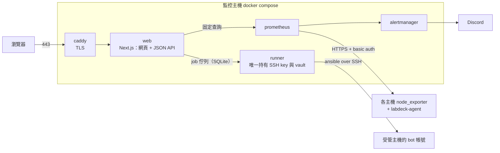

<p align="center">
  
</p>

# LabDeck

> **LabDeck** is a self-hosted dashboard for small research labs that share a handful of GPU servers.
> It keeps an inventory of the hosts, manages Linux accounts and SSH keys across them (newcomers register their needs, admins
> assign accounts and hosts; dry-run previews for bulk changes), monitors GPU, CPU, memory and disk usage per user with Prometheus,
> and sends Discord alerts. One monitoring host runs everything with Docker Compose; managed
> hosts only need SSH and sudo. The UI and documentation are in Traditional Chinese.

給實驗室或小型團隊用的 GPU 主機監控與帳號管理系統。一台監控主機跑 docker compose，
被管主機只需要 SSH 與 sudo；主機在網頁上新增，repo 內不含任何站點資料。

## 功能

- **主機清冊與硬體自動收集**：OS、kernel、CPU、RAM、GPU、NVIDIA driver/CUDA、磁碟、掛載點，每晚自動更新
- **帳號生命週期**：既有帳號認領、各主機授權、鎖定、到期、線上申請與核准、SSH key 自助管理；UID 集中分配，所有變更先 `--check --diff` 再套用
- **監控**：GPU／CPU／RAM／磁碟／網路、每位使用者的 CPU／RAM／磁碟用量、SMART；網頁內建圖表（主機總覽，「使用量」的 GPU 即時、CPU·記憶體、磁碟與月報）
- **告警**：主機離線、GPU 消失、掛載點消失、磁碟將滿、記憶體不足／swap／OOM（附上用量最多的使用者）、GPU 過熱、SMART 異常、收集腳本停擺，送到 Discord
- **個人通知**（選填）：帳號到期、主機維護，以 Discord 提及或 Email 通知
- **新成員指南與維護日曆**：管理員在網頁上編輯的 Markdown 指南；公告與主機維護的月曆，可用 iCal 網址訂閱
- 遠端電源控制（IPMI）與排程關機目前已移除
- **稽核紀錄**：誰在何時對哪台主機做了什麼

## 架構



主機清冊存在 SQLite；runner 依它產生 Ansible inventory 與 Prometheus 的抓取目標。全部以 TypeScript 撰寫（Node.js 24），主機端收集程式是 Rust。
各部件之間的介面約定見 [docs/design.md](docs/design.md)，前後端 API 見 [docs/api.md](docs/api.md)。

| 目錄 | 內容 |
|---|---|
| `apps/web/` | Next.js：網頁與 JSON API |
| `apps/runner/` | runner：依 allowlist 跑 ansible job、排程、通知寄送 |
| `packages/core/` | web 與 runner 共用：設定、SQLite schema、驗證、job、Prometheus 查詢 |
| `ansible/` | playbooks（inventory 由 runner 從 DB 寫出） |
| `crates/agent/` | labdeck-agent：部署到主機的收集程式（Rust 靜態執行檔，建置進 runner image） |
| `deploy/` | Caddy、Prometheus、Alertmanager 設定；`deploy/updater/` 自動更新腳本 |
| `scripts/` | 產生 `secrets/` 的腳本 |
| `dev/`、`compose.dev.yaml` | 開發環境與 toolbox（`./labdeck`，見 docs/docker.md） |
| `e2e/` | 端對端測試（假 OAuth、假 GPU 主機、Playwright） |

## 需求

- **監控主機**：Linux、Docker Engine 與 compose v2（其他什麼都不用裝）；連得到各主機的 SSH（22）與 node_exporter（9100）。
- **被管主機**：Ubuntu 20.04 以上（python3）、SSH、一個有 sudo 權限的既有管理帳號（只在初次 bootstrap 時使用）；
  GPU 主機需已安裝 NVIDIA driver。node_exporter 與 labdeck-agent 目前只支援 x86_64（linux-amd64）。
- **登入**：支援 authorization code flow 的 OAuth 2.0 身分提供者，例如 NYCU；在 `.env` 的 `OAUTH_*` 設定。

## 快速開始

監控主機上只需要 Docker；web、runner、caddy 是 GitHub Actions 建好放在 GHCR 的 image，不必 clone repo 或在主機上建置。
完整步驟見 [docs/deploy.md](docs/deploy.md)，大致是：

```sh
mkdir labdeck && cd labdeck
curl -fsSL https://github.com/<owner>/labdeck/archive/refs/tags/v<版本>.tar.gz \
  | tar xz --strip-components=1 --wildcards '*/compose.yaml' '*/deploy' '*/.env.example'
cp .env.example .env && chmod 600 .env          # 填網址、OAuth、SESSION_SECRET、LABDECK_VERSION
docker compose pull                             # 下載 image
docker compose run --rm --no-deps --user 0:0 -v "$PWD/secrets:/secrets" runner labdeck-init-secrets /secrets
docker compose up -d
docker compose exec web labdeck add-admin <sso_id> <linux_username>
```

之後在網頁 `/admin/hosts` 新增主機，於監控主機上 bootstrap 一次 bot 帳號，再按「安裝監控」與「收集資料」。
升級：`docker compose pull && docker compose up -d`（見 [docs/deploy.md](docs/deploy.md#升級)）；從舊名稱 lab-dashboard 升級：見 [docs/deploy.md](docs/deploy.md#從-lab-dashboard-升級)（volume 名稱改變）。
也可以啟用自動更新：監控主機定時從 GHCR 拉新版，健康檢查沒過就自動換回舊版（見 [docs/deploy.md](docs/deploy.md#自動更新cd)）。

開發也只需要 Docker：`./labdeck dev` 起一套有 hot reload、假登入與假 GPU 主機的開發環境（http://localhost:8080 ），
`./labdeck test`、`./labdeck lint`、`./labdeck e2e` 在容器內跑全部檢查，見 [docs/docker.md](docs/docker.md)。

## 設定

| 位置 | 內容 |
|---|---|
| `.env` | 網址、站名、時區、OAuth、bot 帳號、保留帳號、UID 區段、資料碟 glob、通知管道；變數與預設值見 `.env.example` 與 design.md 約定 B |
| `secrets/` | SSH key、vault 密碼、`vault.yml`（ansible-vault 加密）、node_exporter 憑證與密碼、Discord webhook；見約定 A 與 `ansible/vault.yml.example` |
| `deploy/` | Caddy 憑證來源（由 `.env` 的 `CADDY_TLS` 選）、Prometheus 告警規則、Alertmanager 路由 |
| 網頁 | 主機、群組、帳號與授權、管理員（只能升級；降級用伺服器指令，見 docs/admin-guide.md）、新成員指南 |

`.env` 與 `secrets/` 都在 `.gitignore` 內，請另外備份。

## 安全

runner 是唯一持有 SSH key 與 vault 的服務，web 只能排入 allowlist 內的 job，帳號變更一律先 dry-run；
對外只有 Caddy，Prometheus 不對外。威脅模型摘要與漏洞回報方式見 [SECURITY.md](SECURITY.md)。

## 文件

- [docs/admin-guide.md](docs/admin-guide.md)：助教手冊（新成員開通、連結舊成員、指派／移除主機、公告與維護、畢業生帳號）
- [docs/deploy.md](docs/deploy.md)：部署、新增主機、備份、疑難排解、測試
- [docs/docker.md](docs/docker.md)：Docker 的正式／開發模式、`./labdeck`、e2e、疑難排解
- [docs/design.md](docs/design.md)：架構與各部件的介面約定
- [docs/api.md](docs/api.md)：前後端 JSON API
- [CONTRIBUTING.md](CONTRIBUTING.md)：開發環境、測試、commit 慣例

## 授權

MIT License，見 [LICENSE](LICENSE)。
